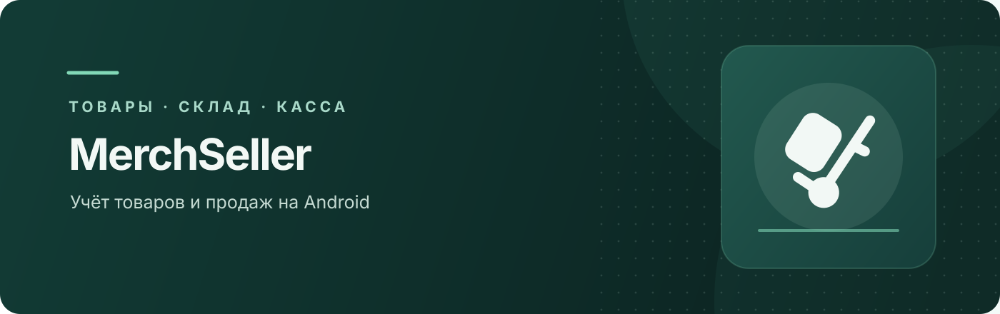

<div align="center">



# MerchSeller

**Учёт товаров, склад и продажи на Android — даже без интернета.**

[](https://github.com/StravyVox/MerchSeller/releases/latest)
[](https://github.com/StravyVox/MerchSeller/actions/workflows/android-ci.yml)
[](LICENSE)

[Скачать последнюю версию](https://github.com/StravyVox/MerchSeller/releases/latest) · [Открыть исходный код](https://github.com/StravyVox/MerchSeller)

</div>

MerchSeller — локальное Android-приложение для каталога товаров, складских остатков и продаж. Товары, чеки и история хранятся на устройстве; интернет нужен для проверки релизов и загрузки обновлений.

## Что умеет приложение

- **Вести каталог:** хранить фото, описание, тип товара, уникальный код, цену без НДС, ставку НДС, цену с НДС и остаток.
- **Организовать склад:** создавать типы товаров, просматривать остатки и находить позиции с низким запасом.
- **Продавать по коду:** сканировать QR-коды камерой, собирать чек и выбирать оплату картой или наличными.
- **Хранить историю:** просматривать продажи и редактировать способ оплаты и комментарий к чеку.
- **Анализировать продажи:** смотреть выручку, количество продаж, средний чек и остатки.
- **Печатать этикетки:** собирать PDF-листы формата A4 с QR-кодами, настраивать число строк и столбцов, включать или отключать фотографии.
- **Переносить данные:** экспортировать каталог и чеки в JSON и импортировать их на другом устройстве.

### Продажа

1. Откройте новый чек.
2. Сканируйте код товара или выберите позицию из каталога.
3. Проверьте список товаров и итог.
4. Выберите оплату картой или наличными и завершите продажу.

При завершении чека показывается анимация. Продажа записывается в локальную историю, а складской остаток обновляется.

### Резервная копия и перенос

Резервная копия — незашифрованный JSON-файл размером до 8 МиБ. Новая копия может включать фотографии в формате JPEG с длинной стороной до 640 пикселей. Если фото недоступны или файл превышает лимит, приложение позволяет экспортировать данные без фотографий. Перед импортом оно предупреждает, что текущая локальная база будет заменена. Старые копии с URI-ссылками на фотографии тоже поддерживаются. Системное резервное копирование Android не включает базу товаров и продаж.

### Цены и расчёты

Цены и итоги хранятся в целых копейках. Для новых продаж цена единицы с НДС округляется до копейки: половина копейки округляется вверх. Итог позиции равен цене единицы, умноженной на количество; итог чека — сумме позиций. Ранее сохранённые чеки сохраняют записанный итог.

## Скачать и обновить

Откройте [страницу последнего стабильного релиза](https://github.com/StravyVox/MerchSeller/releases/latest) и скачайте APK. Для установки на Android откройте загруженный файл и подтвердите установку в системном окне.

Приложение проверяет новые стабильные версии в публичном репозитории GitHub. При наличии обновления оно загружает APK, сверяет SHA-256, если контрольная сумма передана GitHub, и открывает системный установщик. Установку всегда подтверждает пользователь. Предварительные версии и черновики не предлагаются; учётная запись GitHub для загрузки не нужна.

## Сборка из исходного кода

Нужны Android Studio, JDK 17 и Android SDK Platform 36 (Android 16). В корне проекта выполните:

```powershell
.\gradlew.bat assembleDebug
```

В Linux или macOS:

```bash
./gradlew assembleDebug
```

Отладочный APK появится в `app/build/outputs/apk/debug/app-debug.apk`. Установка на подключённое Android-устройство:

```bash
adb install -r app/build/outputs/apk/debug/app-debug.apk
adb shell am start -W -n com.merchseller/.MainActivity
```

Для локальной сборки релиза можно передать Gradle properties `releaseVersion`, `releaseVersionCode`, `releaseStoreFile`, `releaseStorePassword`, `releaseKeyAlias` и `releaseKeyPassword`. Без настроек подписи `assembleRelease` создаёт неподписанный APK.

## Публикация релиза

Workflow `Publish Android release` запускается вручную из ветки `main`. Сначала отправьте тег стабильной версии, который указывает на уже включённый в `main` коммит:

```bash
git tag v1.2.3
git push origin v1.2.3
```

Затем откройте GitHub Actions → `Publish Android release` → `Run workflow`, выберите ветку `main` и укажите тег. Workflow проверит тег, соберёт APK без ключа подписи, подпишет его в отдельной задаче и создаст GitHub Release с APK `MerchSeller-v1.2.3.apk`. Формат тега — `vMAJOR.MINOR.PATCH`; номер версии Android вычисляется из его компонентов.

Для подписания настройте окружение GitHub Actions `release` и добавьте в него секреты:

| Секрет | Значение |
| --- | --- |
| `MERCHSELLER_SIGNING_KEY_BASE64` | Хранилище ключа подписи, закодированное в Base64 |
| `MERCHSELLER_SIGNING_STORE_PASSWORD` | Пароль хранилища |
| `MERCHSELLER_SIGNING_KEY_ALIAS` | Псевдоним ключа |
| `MERCHSELLER_SIGNING_KEY_PASSWORD` | Пароль ключа |

Включите для окружения обязательное подтверждение выпуска ответственным участником. Не добавляйте хранилище ключа в репозиторий. Используйте один и тот же закрытый ключ для всех версий: после его замены обновление поверх установленной версии может быть невозможно.

## Технологии

- Kotlin, Jetpack Compose и Material 3
- Room и SQLite для локальной базы данных
- CameraX и ML Kit для сканирования QR-кодов
- Android `PdfDocument` и ZXing для PDF-этикеток
- Android SplashScreen API

## Структура проекта

```text
app/src/main/java/com/merchseller/
├── data/                  # База данных, модели, расчёты и JSON-резервные копии
├── ui/                    # Цвета, типографика и элементы интерфейса
├── MainActivity.kt        # Навигация и интерфейс
├── MerchViewModel.kt      # Каталог, склад и открытый чек
├── GitHubUpdateManager.kt # Проверка и загрузка релизов GitHub
├── BarcodeScanner.kt     # Сканирование кодов камерой
└── PdfLabelsExporter.kt  # Создание PDF-этикеток формата A4
```

## Лицензии

MerchSeller распространяется по лицензии [MIT](LICENSE). Она разрешает использовать, изменять и распространять программу при сохранении уведомления об авторском праве и текста лицензии.

В интерфейсе используются иконки [Lucide](https://icon-sets.iconify.design/lucide/), а основная иконка приложения основана на [trolley-filled из Tabler Icons](https://icon-sets.iconify.design/tabler/trolley-filled/). Уведомления и тексты лицензий включены в приложение: [Lucide](app/src/main/assets/LICENSE-LUCIDE.txt), [Tabler Icons](app/src/main/assets/LICENSE-TABLER-ICONS.txt).
